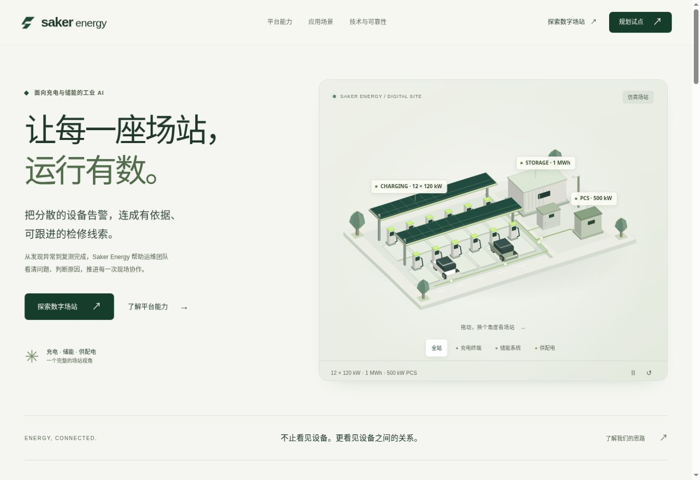

# Saker Energy — 工业 AI 充储场站智能运维

## 产品官网 · 2026-10-21

**已上线：[saker-energy.onrender.com](https://saker-energy.onrender.com/)** · [探索数字场站](https://saker-energy.onrender.com/experience.html) · [规划试点](https://saker-energy.onrender.com/contact.html)

新增完整的产品官网与浏览器交互体验，参考 BXF 的产品展示方式，围绕充电、储能与供配电重新设计。网站包含首页、平台能力、应用场景、技术与可靠性、数字场站、试点规划、隐私说明和 404 页面。

- 原创三维场站：12 个充电终端、储能、PCS、车辆、概念光伏棚与能源路径；支持旋转、聚焦、视角切换和故障高亮。
- 三组预置仿真场景：充电模块过温、储能温差异常和共享供电扰动；趋势、证据、候选原因与工单同步切换。
- 本地模拟工单：人工反馈门槛、复测、失败重开、归档和 JSON 导出。
- 参数化年度收益测算、试点需求清单生成/下载；不自动上传表单内容。
- 零依赖静态多页实现，资源指纹、移动端适配、键盘交互与减少动效支持。

网站代码在 `web/`，维护入口见 [官网文档](docs/website/README.md)、[开发与部署](docs/website/DEVELOPMENT.md)、[发布验收](docs/website/RELEASE.md)。Render 配置见 [render.yaml](render.yaml)。

本次仓库上传及项目升级边界见 [项目改动说明](docs/PROJECT-CHANGELOG.md)。其中区分了已实现的官网/后端原型、已执行的检查、尚未完成的后端复跑，以及面向云桥杯的主动补证与可恢复检修升级路线。

万智平台的接入设计、截图创建步骤、Agent 提示词和本机会话联调工具见 [万智接入实施方案](docs/integrations/wanzhi/README.md)。四轮真实 API 调用记录已通过现有合同校验，输入均为合成开发样例；大屏集成、自动补证与现场诊断准确性仍未验证。



```sh
# Node.js 22+；Render 使用 Node.js 24
npm run dev
npm run check
npm test
```

**官网与交互仿真已实现，不代表真实设备接入、诊断服务、生产工单或工业验收已完成。** 原始工业产品规划保留如下。

## 工业产品基线

工业 AI 应用创新赛实施与验收基线 **v1.0 / 2026-10-16**。本仓库初始提交为**实施计划和验收规范**，不代表应用已经实现或指标已达标。

## 产品定位
面向新能源充电站与储能站的跨设备异常感知、可解释根因辅助诊断、可恢复 Agent 检修工单闭环；AI 建站规划是 P1 扩展能力。

## P0 演示
12 个 120 kW 充电终端、1 MWh 储能、500 kW PCS 的**仿真场站**，可重放充电模块过温、储能温差异常、场站级供电扰动。完成：采集→检测→多设备关联→候选根因→安全门→人工工单→模拟复测→审计归档。

## 核心原则
- LLM **不允许**下发停机、合闸、复位、解锁、储能充放电等设备控制指令。
- 现场检修只允许有资质人员按现场规程实施；安全保护由 BMS/PCS/EMS 及硬件联锁负责。
- 真实背景、合成故障和纯模拟数据必须分层标记，指标采用固定版本、固定随机种子复现。
- 不把相关性当作已证实的因果性，不把目标值当成实验结果。
- 与传统告警、时序模型、RAG 单 Agent 开展 A/B/C/D 基线比较。

## 文档目录
- [产品需求与范围](docs/01-PRD.md)
- [架构与数据流](docs/02-ARCHITECTURE.md)
- [FaultBench 数据与标签](docs/03-DATA-FAULTBENCH.md)
- [Agent、API与工作流](docs/04-AGENT-API.md)
- [工业安全与合规](docs/05-SAFETY-SECURITY.md)
- [实施路线图](docs/06-IMPLEMENTATION.md)
- [验收与测试矩阵](docs/07-ACCEPTANCE.md)
- [实验与评测](docs/08-EXPERIMENTS.md)
- [五分钟演示与答辩](docs/09-DEMO-DEFENSE.md)
- [商业试点与ROI](docs/10-PILOT-ROI.md)
- [风险与架构决策](docs/11-RISKS-ADR.md)
- [发布门禁](docs/12-RELEASE-CHECKLIST.md)
- [故障分类目录](data/fault_catalog.csv)

## 技术选型
Go API + PostgreSQL/TimescaleDB + NATS/MQTT + Python 时序检测 + Saker 持久化任务编排 + Next.js 大屏 + RAG；充电桩通过 OCPP / CitrineOS 适配，储能通过 OpenEMS / 厂商协议或仿真器适配。正式选型前核实协议版本与许可证。

## 完成定义
全部 P0 验收项附运行证据；三个故障场景至少各独立重复三次；所有安全门控测试通过；固定评测数据的 A/B/C/D 结果可复算；比赛现场支持离线回放并显式注明仿真。

## 外部参考
- https://github.com/citrineos/citrineos-core
- https://github.com/OpenEMS/openems
- https://ev.caltech.edu/dataset
- https://www.nasa.gov/intelligent-systems-division/discovery-and-systems-health/pcoe/pcoe-data-set-repository/

