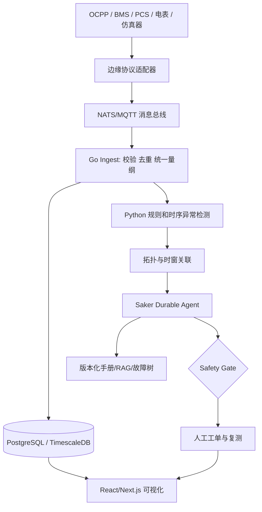

# 02 架构、部署与数据契约

## 服务职责
gateway：设备协议转换、离线缓冲、受控只读、时间戳；ingest：Schema校验和幂等；detector：规则/EWMA/模型版本化；correlator：共享电气拓扑与告警时间窗；agent：证据采集、检索、诊断、等待人工事件；workorder：审批与状态机；audit：追加式事件日志和完整追踪。

## 最小数据契约
Telemetry = tenant_id,site_id,device_id,point,unit,value,device_time,received_at,quality,source,trace_id。
Alarm = event_id,device_id,alarm_code,observed_at,severity,raw_ref。
Diagnosis = event_id,hypotheses[{cause,rank,support,against}],next_checks,abstain,model_version,prompt_version,knowledge_version。
WorkOrder = id,event_id,status,assignee,approval,checks,feedback_refs,created_at,updated_at。

## 工业可靠性
原始时间与接收时间并存；时间漂移超限标记数据不可依赖；消息重复不产生双重工单；LLM 断线时降级规则告警与人工处理；所有跨服务请求有 trace_id。真实生产接入坚持只读影子模式。

## 部署
local: Docker Compose + 固定随机种子 + 离线知识库；competition: 预置故障回放与可展示的真实执行标识；pilot: 独立环境 + 专项现场安全与数据审查。数据保留与备份策略在试点前确定。
