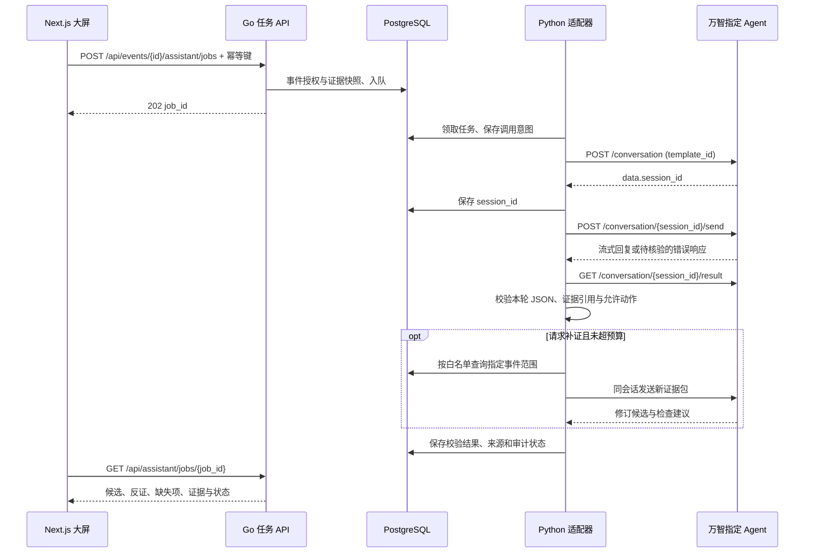

# 万智接入实施方案

更新：2026-10-29（北京时间）。状态：**首轮及三个分支的真实 API 调用记录已复核，四轮均通过现有结构化合同校验；大屏、任务队列与自动补证仍待实施**。输入均为合成开发样例，不能用于宣称现场诊断准确性。复核证据见 [真实调用里程碑](observations/2026-10-29-live-milestone-verified.md)。

当前可执行入口：[本机配置与联调](LOCAL-RUN.md)；平台操作：[按截图创建Agent](CREATE-AGENT.md)；首轮输出之后：[纠正与补证测试](FOLLOWUP-TESTS.md)。完整方案与后续目标保留如下。

## 1. 结论与范围

采用“Next.js 大屏 → Go 本地任务 API → Python 万智适配器 → 指定万智专属员工/工作流”的出站调用链。万智负责分析事件证据、提出区分候选所需的补证请求、根据补充信息修订候选及起草检查清单。数据查询、预算、权限、持久化和工单审批由本地服务执行。

第一版只做一个 Agent：**Saker Energy 充储场站证据诊断助手**。先打通一个事件、一轮诊断、结构化返回，再扩展主动补证。保留现有规则诊断作基线和降级路径；不把网站改造成上传原始设备数据的入口。

本方案没有要求万智反向访问本机 `localhost`，不需要公网隧道，也不新增设备控制能力。万智提出的 `requested_evidence` 是应用层 JSON 协议，不是已经验证的万智原生 function calling。

依据：用户提供的 [本地 HTML 快照](../../../万智大模型一站式平台.html)、本仓库 `backend/` 源码，以及当天核查的赛事公告。快照接口摘录和未知项见 [API-REFERENCE.md](API-REFERENCE.md)。提示词、示例和 Schema 见本目录其他文件。

## 2. 三种接法的选择

| 方案 | 平台接口 | 适用性与本次决策 |
| --- | --- | --- |
| 指定专属员工/工作流 | `/conversation` 创建，`/{id}/send` 发送 | **主方案**。明确绑定团队配置的 Agent/工作流，便于控制提示词、知识来源和提交版本。 |
| 通用 Agent 异步任务 | `/default-agent/chat`、`/default-agent/tasks/{task_id}` | 备选。HTTP 202 后可查任务状态，但需要 `default_agent` 权限，且请求没有指定自建 `agent_id` 的字段；不能假定等同于已发布参赛 Agent。 |
| 万智网页独立配套 | 发布 Agent，人工传递脱敏证据 JSON | 集成延期时的保底。必须真实完成证据分析，并如实标注人工传递；不声明端到端自动调用。 |

不按 OpenAI `/v1/chat/completions` 设计：本 HTML 给出的是万智应用 OpenAPI。`OpenAPI Key` 与 `model_api_key` 不同，前者用于 Bearer 鉴权；虽然后者在快照中列为可选，本账户实测需要单独提供有效模型凭据，不能把 OpenAPI Key 填入模型字段。当前模型凭据已在本机加密配置。

## 3. 一次任务的完整数据流



第一阶段明确执行两步：

1. `POST https://www.wanzhi.com/app/api/v1/open-api/conversation`，JSON 为 `{"template_id":"<平台真实ID>","title":"Saker event <id>","external_uid":"<本地不透明用户标识>"}`。校验 HTTP 状态、业务 `code` 和 `data.session_id`，持久化后再发消息。
2. `POST .../conversation/{session_id}/send`，JSON 为 `{"content":"<序列化的证据JSON>","language":"zh"}`；暂不传文件、`model_api_key` 或未验证的高级参数。

所有请求带 `Authorization: Bearer <OpenAPI Key>`。请求路径中的 `conversation_id` 使用返回的 `session_id`；不是本地 `event_id`，也不是 Agent ID。可选参数未配置时省略，不照抄文档中的空字符串。

`/conversation/send` 自动创建会话可在后续替换两步方案：初次传 `agent_id`，从 `type=session_init` 的 SSE 消息取 `session_id`。两条路径先只选一条实现，避免重复会话。

## 4. 万智平台的实际配置顺序

1. 打开“专属员工”，创建上述 Agent；名称和运行版本记入发布记录。将 [AGENT-PROMPT.md](AGENT-PROMPT.md) 的提示词正文放入系统指令。
2. 在平台模型配置中选定可用模型并记录真实名称、配置与可见版本；不猜测账户支持的模型，也不把模型库 API Key 当成 OpenAPI Key。
3. 暂不授权任意网络、代码执行、浏览器操作和设备工具。首版只消费证据包，并输出补证建议；是否关闭工具以平台实际可配置选项为准。
4. 用示例证据包跑通“证据不足→补充证据→修订”的真实交互。JSON 约束是提示词加本地校验；HTML 没有证明支持原生 JSON Schema 强制输出。
5. 若要知识库，先仅上传团队自有的故障分类、只读检查说明和安全边界。每段带文档 ID、版本、适用范围；原始计划文档和历史成绩报告不作为设备手册/故障真值。
6. 初期优先在“知识工厂”人工导入并验证检索，随后再自动化文档上传。知识库设 `visible_range=1`（私有）；公开 Agent 的访客是否可使用绑定知识库，需要用访客视角实测。
7. 发布并取得真实 Agent 公开 URL，记录专属员工/工作流标识。`template_id` 的取值来源以平台详情/发布页或正式导出为准；HTML 未给出列举 Agent ID 的 OpenAPI，不从分享 URL 猜 ID。
8. 在“API key管理”新建专用 Key，只授予所需对话/指定 Agent 与知识检索权限；权限选项名称以实际页面为准。页面快照显示“0/0、暂无数据”，不能推定当前已有可用 Key。
9. Key 只写入后端本地密钥配置。不要粘贴到聊天、前端 `NEXT_PUBLIC_*`、提交材料或公开仓库。
10. 用不含 Key 的运行记录证明公开 Agent 与 API 调用对应同一任务和版本。公开 URL 与 API 权限是两项检查，不能相互替代。

## 5. 证据输入与决策输出

输入示例：[evidence-package.example.json](evidence-package.example.json)。所有数字是人为构造的开发样例，不是运行成绩。单事件只上传时间窗摘要、必要测点、拓扑事实、质量与缺失标记；禁止整个数据库、客户身份和无关日志外发。

必备字段：`schema_version`、`event_id`、`input_revision`、`round_id`、`trace_id`、`data_origin`、`evidence[]`、`available_queries[]`、`query_budget_remaining`。每条证据有 ID、来源/版本、时间、设备、量纲及质量。使用 UTC 时间；相对时间样例也须明确基准。

不得将注入器的 `--fault` 标签、评分答案或原先故障树预排候选发给主评测 Agent。现有 `event_type` 直接映射故障码，主评测需使用中性异常描述；规则基线自己的诊断另外保存。

输出示例：[decision.example.json](decision.example.json)；格式约束：[decision.schema.json](decision.schema.json)。输出包含候选排名、支持/反证 ID、缺失信息、短证据解释、补证请求、人工待核验清单和 `abstain`。`abstain=true` 表示不作确定性根因结论，仍可提出候选。

本地额外语义校验（Schema 无法独立保证）：

- `event_id`、`input_revision`、`round_id` 必须与本轮一致；候选 ID 不重复，rank 连续。
- 引用 ID 必须属于本轮提供的证据或白名单知识片段，不能编造测量、来源、检查完成或维修效果。
- 工具只能引用 `available_queries` 中的 `query_id`，不接受任意 SQL、URL、shell、设备控制参数。
- 后端重新验证事件归属、时间窗、设备范围、当前剩余预算与查询结果质量，不依赖模型自行计数。
- 每次最多一项补证；一次查询扣一预算单位，最多三次，单事件最多四次 Agent 发送（首次加三次补证）。预算耗尽后收敛到候选/人工复核，不允许无限循环。
- 失效时间戳、证据矛盾、高风险储能或未知根因要求人工复核；JSON 合法不等于判断正确。
- 输出始终只生成建议，不自动建立已批准工单、不修改原始遥测、不直接结案。

第一版只实现 `telemetry_window`、`topology_neighbors`、`manual_search` 三类本地只读查询。调度记录、上游保护记录、独立校准测量在当前仓库没有可信数据源，只标记缺失；后续取得数据后才能增加查询。相同查询的缓存命中仍记录引用和来源，不把重复查询伪装成新证据。

## 6. 完整集成目标清单（分阶段实施，以页首和运行记录为准）

| 文件/模块 | 改动及完成定义 |
| --- | --- |
| `backend/integrations/wanzhi_client.py`（新增） | 封装创建、发送、结果、详情、停止；密钥脱敏；真实响应捕获；根据 Content-Type 解析 SSE 或错误 JSON。 |
| `backend/agent/evidence.py`（新增） | 从事件和限定时间窗生成证据快照，移除注入标签，保留单位/质量/来源；执行白名单补证。 |
| `backend/agent/wanzhi_worker.py`（新增） | 领取本地任务、保存调用与会话、限制轮数、校验输出、恢复/降级；与旧规则 Agent 分离。 |
| `backend/workorder/main.go` | 新增下表任务 API、授权与幂等性，修复事件详情空字段/序列化契约；不让模型调用现有状态更新接口。 |
| `backend/migrations/002_assistant_jobs.sql`（新增） | 新建 `assistant_jobs`、`assistant_rounds`、`assistant_evidence` 和必要索引；使用独立迁移命令，不能假定旧数据库会重跑 Docker 首次初始化。 |
| `dashboard-next/app/assistant/page.tsx`（新增） | 事件选择、诊断任务、证据与反证、补证记录、失败/降级状态和人工交接；初期轮询本地任务。 |
| `dashboard-next/next.config.ts` | 主机进程沿用 `localhost:8080`；若容器部署则改为服务名/明确网关，不能把容器 localhost 当作宿主机。 |
| 后端独立环境示例与启动脚本 | 从环境读取 Key；只启动本项目 PID，不沿用 `start_all.ps1` 中终止所有 Python 进程的逻辑。 |
| `backend/tests/`（新增） | 传输/Schema/证据引用/幂等/超时/恢复测试；fixture 测试与真人平台调用分开标记。 |

本地新接口与上游万智 API 分开命名：

| 拟新增本地路由 | 行为 |
| --- | --- |
| `POST /api/events/{id}/assistant/jobs` | 请求 `input_revision`、请求头 `Idempotency-Key`；202 返回本地 `job_id`，只入队，不等待模型。 |
| `GET /api/assistant/jobs/{job_id}` | 返回状态、本轮结果、补证和错误类别；不返回上游密钥。 |
| `POST /api/assistant/jobs/{job_id}/observations` | 已授权人工提交观察与来源，增加输入版本，在相同案例会话继续；不能把点击确认当作维修事实。 |
| `POST /api/assistant/jobs/{job_id}/cancel` | 记录取消意图，尝试停止上游；停止确认前仍标记处理中，不保证上游费用被撤销。 |

以上路由目前不存在。现有 `/api/events/{id}`、`/api/alarms`、`/api/telemetry/latest` 缺少完整事件证据包、历史窗口和多租户隔离，不宜原样直接暴露给万智。

拟建表关键约束：`assistant_jobs` 保存 tenant/site/event、模式、输入快照哈希、幂等键、Agent/提示词/知识版本、provider_session_id、状态与租约；同一租户幂等键唯一，键复用但请求体不同返回409。同事件同输入版本/Agent配置只允许一个活动任务。`assistant_rounds` 保存本地 round_id、remote response_id（若提供）、请求哈希、发送意图和结果。`assistant_evidence` 保存不可变证据与来源引用。

Worker 用数据库事务领取任务（如 `FOR UPDATE SKIP LOCKED` 加租约），不能持锁等待网络。服务重启后租约可回收，但要先对账远端调用状态，不能直接重发。旧 `agent/main.py` 只筛选无诊断的 OPEN 事件，不能让新 Worker 共用该筛选方式，否则规则结果会阻挡万智任务。

## 7. 持久化、流式与失败处理

本地状态：`QUEUED → RUNNING → NEEDS_EVIDENCE / NEEDS_HUMAN / COMPLETED`；另有 `CANCEL_REQUESTED / CANCELLED / FAILED / DEGRADED / UNKNOWN_REMOTE_STATE`。这些是本方案自己的状态，不代表万智状态枚举。`COMPLETED` 只指诊断建议通过格式与引用校验，不代表设备修复或工单关闭。

以明确创建会话为首选，提前保存 `session_id`。每轮串行发送，保存本轮关联标识和先前历史位置；流式结束后读取 `/result`，结合 `/detail` 的实际消息标识定位当前 assistant 最终结果。不得抓最后一个任意消息或复用上轮回答充当成功。

HTML 没有给全 SSE 事件格式、结束事件和会话 status 枚举。首次联调必须记录真实脱敏响应，覆盖分片、空行、多行 data、中文与错误事件。只有确认实际完成状态/结束标识、当前轮最终正文和合法 JSON 后才能完成本地任务；断流与未知字段先标记待对账。

建议初始本地参数（不是平台限额）：连接超时10秒，流读空闲超时60秒，单轮总期限180秒，单事件最多4轮。读取详情/结果用有上限退避；限流遵守实际 `Retry-After`。实际费用、上下文窗口和并发额度需要从账户确认，不给未核实报价。

| 情形 | 处理 |
| --- | --- |
| HTTP 401/403 或业务 code 非成功 | 核对 Key、权限、Agent 资源范围；不循环盲重试，不回显密钥。 |
| HTTP 422 | 按本快照与实际响应核对请求；不自动换成其他厂商请求格式。 |
| 429/5xx | GET 可有限退避；POST 若是否已提交不明确，先对账。 |
| 创建/发送超时、连接中断 | 本地幂等不能保证上游 exactly-once。记录 `UNKNOWN_REMOTE_STATE`，查列表/详情/结果、按外部标识/消息轮次对账；无法唯一确认时交人工，避免盲重发产生重复成本。 |
| JSON 不合法、引用不存在或越权补证 | 结果不采纳，进入人工复核/明确规则降级，保存失败原因；首版不额外无限修复调用。 |
| 平台停用或断网 | 保留规则结果，并显示来源 `RULE_FALLBACK`；离线录制回放显示 `RECORDED_REPLAY`，均不能写实时万智已运行。 |

## 8. 知识库与上传的实施边界

首版人工导入少量自有文档最短。自动化时顺序为：创建私有知识库 → 申请上传预签名 URL → 按实际返回的地址/方法/字段上传 → 用 `obj_key_list` 创建解析任务 → 查询 document-tasks → 验证文档可检索。**预签名响应示例是 null，不能臆造 PUT/POST 和对象键字段**，应拿到完整 OpenAPI 或联调实测后补齐。

独立知识库检索入口为 `POST /knowledge/{knowledge_id}/query`，本地初始选 `query_type=3`（混合）、`topK=5`、`rerank=true`。对话内嵌的知识检索枚举/权限需单独验证，不能机械照搬独立接口的枚举。知识检索响应的来源/分数结构未展开，必须捕获后再写适配器。

如先由本地适配器调用知识检索并把片段加入证据包，来源和版本以本地文档清单绑定，不让模型自行填写。若万智内部检索无法返回可核对引用，则改用显式片段输入，避免声称已做证据级 RAG 审计。

## 9. 部署、配置与现有阻塞项

第一版采用主机进程：Next.js `:3000`、Go `:8080`、Python Worker、数据库 `:55432`，Worker 经 HTTPS 出站访问万智。浏览器只访问本地 Go；公开 Render 静态站仍只发布 `dist/`，不能执行 Go/Python，新增后端须独立服务部署并验证数据合同。

建议后端环境名（为本项目新增配置，不是万智强制变量）：

```text
WANZHI_BASE_URL=https://www.wanzhi.com/app/api/v1/open-api
WANZHI_OPENAPI_KEY=<仅服务端保存>
WANZHI_TEMPLATE_ID=<专属员工或工作流真实ID>
WANZHI_KNOWLEDGE_ID=<可选，未用则省略>
WANZHI_AGENT_PUBLIC_URL=<真实发布链接，仅用于展示核验>
ASSISTANT_MODE=advisory
```

不得新建包含真实 Key 的 `.env.example`。现有 `.gitignore` 仅明确忽略 `.env`，实施时需补充 `.env.*`（保留不含值的示例）、私有运行记录、快照/本地配置忽略规则；提交前审查暂存内容。

当前保存的 HTML 与 `_files` 目录为未跟踪输入，仅本地分析，不纳入部署、知识库或自动推送。账户页快照可能包含个人/会话信息，不能因前次授权上传项目就顺带上传本次原始快照。

动工前必须处理：

- 规则知识检索遗漏 `version` 后又读取导致的异常，避免规则降级也失败；统一 F07/F12 等跨模块故障标识。
- 工单接口缺少身份验证、严格流转与幂等；万智不能获得创建已批准工单和更改状态的权限。第一版仅本机演示；要开放评委远程服务前补齐访问控制。
- `events/alarms/diagnoses/work_orders` 未形成完整 tenant_id 约束；`external_uid` 只是会话关联，不能当作授权或租户隔离。多用户上线前补迁移和授权测试。
- 核验数据库镜像是否包含 `vector` 扩展；当前迁移请求 `CREATE EXTENSION vector`，不能假定 TimescaleDB 镜像支持。NATS 健康检查依赖 `nats ping` 命令也需确认镜像实际可用。容器启动不等于业务可用。
- 当前 Next.js 版本有独立 AGENTS 约束；真正修改页面前阅读安装版本的本地文档并执行构建。原评测页固定数字不能当万智接入后的指标。

## 10. 分阶段执行与出口

| 顺序 | 工作 | 完成门槛 |
| --- | --- | --- |
| P0，当天优先 | 发布 Agent、确认模型与权限、用样例做真实对话 | 真实公开 URL、非敏感配置记录；一条有输入/输出的任务可重复运行。 |
| P1 | 服务端创建会话、发送、解析、取结果 | session_id 映射正确；本轮 JSON/引用通过校验；无效 Key/超时不会显示成功。 |
| P2 | 本地任务 API、证据快照和大屏展示 | 任务不阻塞请求；刷新能恢复查看；用户只能访问授权事件；保留规则基线。 |
| P3 | 三类只读补证、预算、人工接管 | 新证据可改变候选；不存在的调度/保护数据明确缺失；越权查询被后端拒绝。 |
| P4 | 中断恢复、同预算比较、提交材料 | 原始记录可复核；不伪造提升；说明书与公开 Agent、接口和录像对应同一版本。 |

截止前优先保证 P0–P2，只有真实完成 P3 才申报自动主动补证。若 API 权限或流式契约当天无法核实，转人工传递证据包的独立配套模式，并在材料中准确说明。官方截止仍为2026-10-30 24:00北京时间（2026-10-31 01:00日本时间）；不能把 P3 核心能力留到截止后从零补做。

建议小型开发验收：三个主场景各跑完整证据、缺失证据、冲突证据共9例，另加断流、无权限、重复提交、跨事件引用、超预算、刷新恢复等异常；这是工程用例覆盖，不是统计精度证明。创新增益用独立冻结测试集，在相同观测、查询预算和模型条件下比较规则、固定补证、单次万智和自适应补证；报告成功率、错误确定性、拒答覆盖、查询数/耗时及失败案例，不预填提升数字。

## 11. 首次联调仍需确认的最少信息

- 平台真实的专属员工/工作流 ID、发布 URL 与实际可调用状态。
- OpenAPI Key 的资源范围、账户模型可用性/额度；Key 由用户在本机后端配置，不经聊天传递。
- 已有四轮真实调用记录；后续需补充失败完成事件状态字段、断流及恢复的实测合同证据。
- 是否启用云知识库；若不启用，先使用自有版本化只读片段作为输入。

## 12. 来源与本次完成范围

- 本地 HTML 文件 SHA-256：`cfc32e97d3139b210261047d31d66aa5352b0b9ca35639c46129d3cc4270d9ed`；读取可见 OpenAPI 文档，没有执行保存页面的 JavaScript。
- [赛事万智要求](https://yunqiao.jpx.com/cup/announcements/wanzhi-submission-20261016.html)：实际业务任务与公开 Agent URL，可与独立 Web 配套。
- [作品提交要求](https://yunqiao.jpx.com/cup/resources/submission.html)：运行/复现材料、PDF、视频及截止安排。2026-10-28核查时提交入口已开放，先前“待开放”信息已过时。
- 万智在线账户文档页本次无法由网页工具访问；接口细节以用户快照为依据，运行状态、权限与消息协议均待真人平台联调。

第一阶段已新增 `backend/wanzhi.py` 和 `backend/integrations/`：本机加密配置、指定Agent会话API客户端、流式解析、结果Schema/语义校验、私有检查点和GET-only对账。50项离线测试与四轮真实调用记录分别留存；不能用离线测试替代平台运行证据。数据库队列、主动补证执行器、Go接口和大屏仍是后续目标。未发布服务、未开展真实工业设备实验，实际状态见 [IMPLEMENTATION-STATUS.md](IMPLEMENTATION-STATUS.md)。
