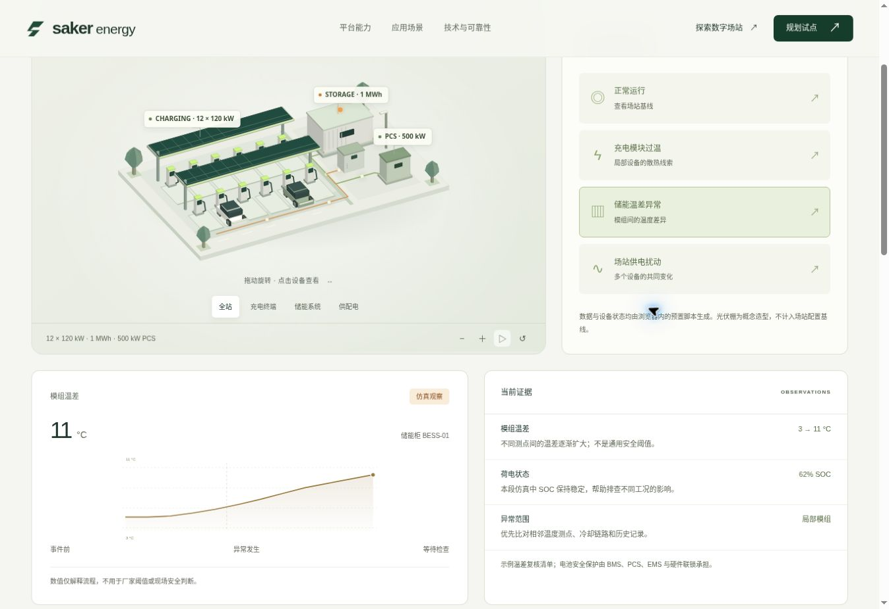

# Saker Energy 网站发布记录

日期：2026-10-21

## 交付范围

- 八个页面：首页、平台能力、应用场景、技术与可靠性、数字场站、规划试点、隐私说明和 404。
- 原生 Canvas 三维场站，支持视角、旋转、缩放、设备聚焦、正常运行与三种异常演示。
- 异常趋势、支持/反对证据、候选原因以及含人工确认和复测分支的仿真流程。
- 年度收益测算、文本导出、试点需求清单生成与下载。
- 响应式布局、键盘导航、减少动态效果设置、静态 SEO、带内容指纹的资源和 Render 发布配置。

本次交付是产品网站和浏览器仿真体验。没有接入真实遥测、AI 推理服务、生产工单或设备控制；站点规模、曲线、诊断与收益示例均已标注语义。原始产品文档保留，不将文档验收目标写作已验证结果。

## 自动检查

执行：`npm run check && npm test`。

- JavaScript 语法与静态构建通过；8 个 HTML 页面、4 个资源文件、208 个本地引用、2 个模块引用检查通过。
- 页面标题、描述、模板替换、重复 ID、ARIA 控件引用和内部锚点检查通过。
- 只发布 `dist`，未复制产品文档、开发源码、数据目录或本地验收入口。
- 7 项自动化测试通过：收益公式、负收益与零投入、无效值与数值溢出、禁止提前授权、复测失败重开、场景隔离、场景数据和证据完整性。

## 浏览器验收

在 Chromium 桌面视口（1363 × 936）及 390px 响应式验收框架中检查。响应式框架用于验证 CSS 布局和交互，不等同于真实手机设备测试。

| 检查 | 结果 |
| --- | --- |
| 首页和 Canvas 场站 | 模型、设备标签、视角与页面层级正常显示。 |
| 窄屏布局 | 首页无水平溢出，移动导航可打开并进入试点页面。 |
| 场景切换 | 供配电扰动的设备状态、趋势、证据与候选原因同步更新。 |
| 人工确认门槛 | 未勾选人工反馈时停在等待人工阶段，提示补充确认。 |
| 复测失败 | 返回调查阶段并清除旧确认；再次确认并复测通过后归档。 |
| 收益测算 | 示例为净收益 −14,800 元和 ROI −37%；零投入显示不适用；越界比例清空结果并禁用导出。 |
| 需求清单 | 必填输入生成正确的本地清单，页面明确尚未发送。 |
| 下载 | 浏览器下载事件完成；取回 800 字节的测试清单并核验项目名和问题描述一致。 |
| 应用错误 | 验收未观察到网站自身的控制台错误；浏览器扩展元数据错误不属于站点脚本。 |

## 发布与运维

部署方式：Render Static Site；仓库 `saker-ai/saker-energy`，分支 `main`，构建 `npm run check && npm test`，发布目录 `dist`。详细设置见根目录 `render.yaml`。

### 首次正式发布

| 项目 | 结果 |
| --- | --- |
| 正式地址 | [https://saker-energy.onrender.com/](https://saker-energy.onrender.com/) |
| 代码提交 | [`250ebf17d9f3d0490bfcabca9b66d28e2cb3f1ec`](https://github.com/saker-ai/saker-energy/commit/250ebf17d9f3d0490bfcabca9b66d28e2cb3f1ec) |
| Render 服务 | `srv-dbc87rbncjis738mjrv0` |
| 首次部署 | `dep-dbc87rjncjis738mjt0g` |
| 状态 | `live`，完成于 2026-10-21 09:21:02 UTC |
| 管理入口 | [Render Dashboard](https://dashboard.render.com/static/srv-dbc87rbncjis738mjrv0) |
| 后续发布 | `main` 新提交触发自动部署；构建检查和测试成功后发布。 |

Render 构建日志确认 Node.js 24.22.0，静态检查通过，7 项测试通过，资源上传完成。公开 `/version.json` 返回的首次发布提交与上述代码提交一致。

### 上线后的核验

- 8 个已构建页面请求均返回 HTTP 200；不存在的路径返回 HTTP 404，并展示本站的自定义页面。
- `robots.txt`、`sitemap.xml`、`version.json` 均返回 HTTP 200。
- 在正式网址加载首页，三维场站正常绘制；进入数字场站后切换储能异常，场景、聚焦设备、温差趋势、支持/反对证据与中文流程状态同步更新。
- 主页、数字场站和试点入口的 HTTPS 地址已在浏览器打开核验。
- 首次发布的 HTTP 检查结果保存在 [qa/http-check.json](qa/http-check.json)。此文件是首次版本的核验快照；当前版本可查看正式网址的 `/version.json`。

后续维护和回滚方式见 [开发与部署](DEVELOPMENT.md)。本次未进行真实硬件、真实手机 Safari、长期负载或工业安全认证验收。

## 2026-10-29 参赛视频与自动回放参数

`evidence-demo.js`增加的 `?autoplay=1` 时间轴随视频制作同步入库；默认按钮回放保留。1920×1080浏览器自动播放连续采集覆盖三步回放；390×844浏览器尺寸下实际点击分析按钮，三步均显示，测得scrollWidth=386≤viewportWidth=390，保留演示来源标注。移动截图与成片关键帧见 `../integrations/wanzhi/submission/video-qa/`。

本次执行网站构建检查：9页、7个JavaScript文件、249个本地引用通过；官网7项测试通过。视频制作及编码、配音与播放验证详见 [交付记录](../integrations/wanzhi/submission/VIDEO-DELIVERY.md)。本次未核验Render部署状态，浏览器尺寸测试不等于真实手机设备测试。
